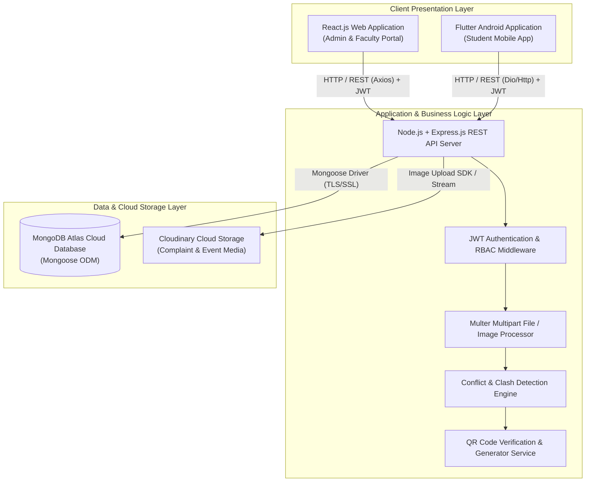

# SMART CAMPUS CONNECT – SYSTEM ARCHITECTURE SPECIFICATION
**Project Name:** Smart Campus Connect  
**Academic Event:** MERNOVA X 2026 – Presidency University  
**Degree Track:** Master of Computer Applications (MCA) Final Year Project  
**Motto:** *One Campus. One Platform. Connected Services.*

---

## 1. Architectural Overview

Smart Campus Connect is architected as a decoupled, multi-client, enterprise-grade cloud system. It connects students, faculty, and administrative staff through specialized client interfaces that share a single unified backend and a centralized cloud database.



---

## 2. Multi-Tier Layer Breakdown

### Tier 1: Client Presentation Layer
1. **React.js Web Portal (Administrator & Faculty)**:
   - Optimized for large-screen data management, tabular filtering, analytics charting, and bulk administrative tasks.
   - Built with React Router (SPA), Axios with automated Bearer Token Interceptors, and modern CSS/Component UI.
   - Role-guarded views ensure faculty only see authorized academic/event management panes, while super-admins maintain full oversight.
2. **Flutter Android Application (Students)**:
   - Optimized for mobile on-campus usability, responsive navigation, and physical hardware access.
   - Built with Google Flutter & Dart framework.
   - Hardware integration includes the Device Camera for high-speed QR scanning (using `mobile_scanner`) and camera/gallery photograph uploads for incident evidence (using `image_picker`).
   - Secure token persistence using encrypted local device storage.

### Tier 2: Backend & Business Logic Tier
- **Node.js runtime & Express.js framework**:
  - Stateless REST API gateway following the strict **Model-View-Controller (MVC)** architectural pattern.
  - **Security & Authorization**: JSON Web Tokens (JWT) signed with SHA-256 HMAC secrets, bcrypt password hashing with 10 salt rounds, input validation sanitization, and Cross-Origin Resource Sharing (CORS) rules.
  - **Service Layer**: Handles specialized algorithms, such as room booking temporal overlap checks (`(newStart < existingEnd) AND (newEnd > existingStart)`), unique ticket generation (`CMP-2026-XXXX`), and QR payload decoding.

### Tier 3: Database & Cloud Asset Tier
- **MongoDB Atlas**:
  - Fully managed, high-availability cloud database hosted on AWS/GCP infrastructure.
  - Connects securely using TLS/SSL connection string with SRV records.
  - Enforces schema strictness, compound unique indexes, and referential integrity through Mongoose ODM.
- **Cloudinary / Cloud Media Storage**:
  - Offloads binary image payload storage to prevent database bloat.
  - MongoDB Atlas only stores validated secure HTTPS asset URLs.

---

## 3. Technology Selection Rationale (For Faculty & Viva Presentation)

| Component | Selected Technology | Why Selected Over Alternatives |
|---|---|---|
| **Web Frontend** | React.js | Fast Virtual DOM, modular component architecture, industry standard for administrative dashboards. |
| **Mobile App** | Flutter & Dart | Native 60fps compiled performance on Android, single codebase, direct access to camera sensors for QR scanning. Outperforms hybrid web-views. |
| **Backend** | Node.js + Express.js | Asynchronous, non-blocking I/O event loop ideal for concurrent mobile and web requests; seamless JSON interoperability across the stack. |
| **Database** | MongoDB Atlas | Flexible document model handles nested complaint histories, variable event metadata, and horizontal scaling without schema migration downtime. |
| **Authentication** | JWT (JSON Web Tokens) | Stateless, self-contained authentication tokens compatible with both web browsers (headers) and native mobile apps without server session memory. |


---

## 4. React Web Application Architecture & Component System

The web frontend is built with React 18, React Router v6, and Vite. It serves as the primary portal for Campus Administrators and Academic Faculty.

```
client/src/
├── assets/                 # Icons & University Branding
├── components/
│   ├── DashboardLayout.jsx # Master responsive shell (Sidebar + Navbar + Content)
│   ├── Navbar.jsx          # Live notification drawer, date badge & user actions
│   ├── ProtectedRoute.jsx  # Role-Based Routing Guard (Admin vs Faculty)
│   └── Sidebar.jsx         # Navigation menu with real-time badges & logout
├── context/
│   └── AuthContext.jsx     # Global authentication, JWT decoding, session state
├── pages/
│   ├── auth/
│   │   └── Login.jsx       # University authentication with quick-fill demo presets
│   ├── admin/
│   │   ├── AdminDashboard.jsx    # KPI stat cards & recent issue tickets
│   │   ├── ManageComplaints.jsx  # Status/priority filtered complaints table
│   │   ├── ComplaintDetails.jsx  # Photo evidence, technician assignment & audit trail
│   │   ├── ManageLocations.jsx   # Venue registry & printable QR code generator
│   │   ├── ManageEvents.jsx      # Event scheduling & attendee rosters
│   │   ├── ManageBookings.jsx    # Room booking approvals with conflict warning
│   │   ├── ManageLostFound.jsx   # Lost property moderation & claims handling
│   │   ├── ManageAnnouncements.jsx# Circular publisher with audience scoping
│   │   ├── ManageUsers.jsx       # Student & faculty user management directory
│   │   └── Analytics.jsx         # SVG complaint distribution & resolution charts
│   └── faculty/
│       └── FacultyDashboard.jsx  # Academic portal with departmental event & notice access
├── services/
│   └── api.js              # Centralized Axios client with Bearer token interceptor
├── App.jsx                 # Route registry & role access rules
├── index.css               # Clean University Design System
└── main.jsx                # Application root mounting
```

### 4.1 Client-Side Role-Based Route Guard Matrix

| Route Path | Allowed Roles | Guard Enforcement | Unauthenticated Action |
|---|---|---|---|
| `/admin/*` | `['admin']` | `ProtectedRoute` | Redirects to `/login` (or `/faculty` if logged in as faculty) |
| `/faculty/*`| `['faculty', 'admin']` | `ProtectedRoute` | Redirects to `/login` |
| `/login` | Public | Open | Redirects to `/admin` or `/faculty` if already authenticated |
