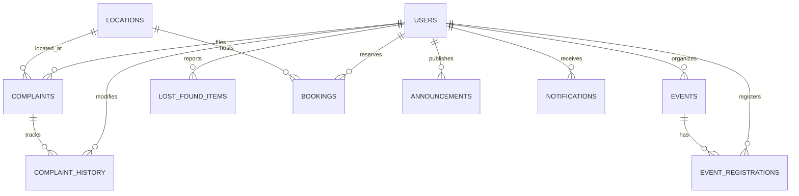

# SMART CAMPUS CONNECT – DATABASE DESIGN & SCHEMA SPECIFICATION
**Host:** MongoDB Atlas (Cloud)  
**Object Data Modeling (ODM):** Mongoose (Node.js)  
**Target Event:** MERNOVA X 2026 – Presidency University

---

## 1. Entity Relationship Overview

The database comprises 10 core collections. All relational associations use Mongoose `ObjectId` references (`ref`), maintaining document agility while enforcing relational integrity.

---

## 2. Collection Schemas & Field Definitions

### 1. `users`
Stores student, faculty, and administrative profiles.
- `_id`: `ObjectId` (Primary Key, auto-generated)
- `fullName`: `String` (Required, trim: true)
- `email`: `String` (Required, unique: true, lowercase: true, index: true)
- `password`: `String` (Required, select: false, bcrypt hashed)
- `role`: `String` (Required, enum: `['student', 'faculty', 'admin']`, default: `'student'`)
- `phone`: `String` (Optional, trim: true)
- `registrationNumber`: `String` (Required for students e.g. "2024MCA001", unique sparse index)
- `employeeId`: `String` (Required for faculty/admin e.g. "PU-EMP-104")
- `department`: `String` (Required, e.g. "School of Computer Science & Engineering")
- `avatarUrl`: `String` (Default placeholder URL)
- `isActive`: `Boolean` (Default: `true`)
- `createdAt`, `updatedAt`: `Date` (Mongoose timestamps)

### 2. `locations`
Stores campus physical entities mapped to unique QR identification strings.
- `_id`: `ObjectId`
- `qrCode`: `String` (Required, unique: true, index: true, uppercase: true, e.g., `"PU-ENGG-LH204"`)
- `buildingName`: `String` (Required, e.g., "Academic Block 1")
- `block`: `String` (Required, e.g., "Engineering Wing")
- `floor`: `String` (Required, e.g., "2nd Floor")
- `roomNumber`: `String` (Required, e.g., "LH-204")
- `roomType`: `String` (Required, enum: `['Classroom', 'Computer Lab', 'Seminar Hall', 'Auditorium', 'Library', 'Restroom', 'Cafeteria', 'Other']`)
- `description`: `String` (Optional, e.g., "60-seater smart classroom with ceiling projector")
- `facilities`: `[String]` (e.g. `["Epson Projector", "Central AC", "Audio PA System", "Smart Podium"]`)
- `qrCodeImageUrl`: `String` (URL of generated QR asset for printing)
- `isActive`: `Boolean` (Default: `true`)
- `createdAt`, `updatedAt`: `Date`

### 3. `complaints`
Stores incident tickets logged by students via QR scan or manual location entry.
- `_id`: `ObjectId`
- `ticketNumber`: `String` (Required, unique: true, index: true, e.g. `"CMP-2026-0001"`)
- `studentId`: `ObjectId` (Ref: `'User'`, Required, index: true)
- `locationId`: `ObjectId` (Ref: `'Location'`, Optional if manual fallback)
- `manualLocation`: `Object` (Optional fallback: `{ buildingName, roomNumber, landmark }`)
- `category`: `String` (Required, enum: `['Electrical', 'Projector', 'Computer/Lab', 'Wi-Fi/Network', 'Furniture', 'Water/Plumbing', 'Cleaning/Maintenance', 'Other']`)
- `title`: `String` (Required, maxlength: 120)
- `description`: `String` (Required, maxlength: 1000)
- `imageUrl`: `String` (Optional HTTPS URL of uploaded photograph)
- `priority`: `String` (Enum: `['Low', 'Medium', 'High', 'Urgent']`, default: `'Medium'`)
- `status`: `String` (Required, enum: `['Pending', 'Assigned', 'In Progress', 'Resolved', 'Rejected']`, default: `'Pending'`, index: true)
- `assignedTo`: `Object` (`{ staffName: String, staffPhone: String, assignedDate: Date }`)
- `rejectionReason`: `String` (Required if status is `'Rejected'`)
- `resolutionNotes`: `String` (Notes by maintenance/admin upon resolution)
- `resolvedAt`: `Date`
- `createdAt`, `updatedAt`: `Date`

### 4. `complainthistories`
Maintains an immutable audit log of ticket transitions.
- `_id`: `ObjectId`
- `complaintId`: `ObjectId` (Ref: `'Complaint'`, Required, index: true)
- `changedBy`: `ObjectId` (Ref: `'User'`, Required)
- `previousStatus`: `String`
- `newStatus`: `String` (Required)
- `actionNotes`: `String` (Optional, e.g. "Work assigned to electrician John Doe")
- `timestamp`: `Date` (Default: `Date.now`)

### 5. `events`
Campus workshops, hackathons, guest lectures, and cultural events.
- `_id`: `ObjectId`
- `title`: `String` (Required, trim: true)
- `description`: `String` (Required)
- `category`: `String` (Required, enum: `['Technical', 'Cultural', 'Sports', 'Workshop', 'Seminar', 'Other']`)
- `organizer`: `ObjectId` (Ref: `'User'`, Required)
- `venue`: `String` (Required, e.g., "Sir MV Auditorium")
- `eventDate`: `Date` (Required)
- `startTime`: `String` (Required, e.g., "10:00 AM")
- `endTime`: `String` (Required, e.g., "01:00 PM")
- `registrationDeadline`: `Date` (Required)
- `maxParticipants`: `Number` (Default: 100)
- `currentRegistrationsCount`: `Number` (Default: 0)
- `bannerImageUrl`: `String` (Optional)
- `status`: `String` (Enum: `['Upcoming', 'Ongoing', 'Completed', 'Cancelled']`, default: `'Upcoming'`)
- `createdAt`, `updatedAt`: `Date`

### 6. `eventregistrations`
Tracks individual student registrations for events.
- `_id`: `ObjectId`
- `eventId`: `ObjectId` (Ref: `'Event'`, Required, index: true)
- `studentId`: `ObjectId` (Ref: `'User'`, Required, index: true)
- `ticketCode`: `String` (Unique alphanumeric e.g. `"EVT-REG-98214"`)
- `status`: `String` (Enum: `['Registered', 'Attended', 'Cancelled']`, default: `'Registered'`)
- `registrationDate`: `Date` (Default: `Date.now`)
- **Compound Unique Index:** `{ eventId: 1, studentId: 1 }` (Strictly prevents duplicate registrations)

### 7. `lostfounditems`
Facilitates lost property recovery across campus.
- `_id`: `ObjectId`
- `type`: `String` (Required, enum: `['Lost', 'Found']`, index: true)
- `postedBy`: `ObjectId` (Ref: `'User'`, Required)
- `title`: `String` (Required, e.g., "Blue HP Laptop Bag with Charger")
- `category`: `String` (Required, enum: `['Electronics', 'ID Cards', 'Books/Notes', 'Keys', 'Wallets/Bags', 'Clothing', 'Other']`)
- `description`: `String` (Required)
- `location`: `String` (Where it was lost/found, e.g., "Central Library 1st Floor")
- `itemDate`: `Date` (Date lost or found)
- `imageUrl`: `String` (Photograph)
- `status`: `String` (Enum: `['Active', 'Claim Pending', 'Resolved/Returned', 'Closed']`, default: `'Active'`)
- `claimer`: `ObjectId` (Ref: `'User'`, optional)
- `claimNotes`: `String` (Details provided by student claiming the item)
- `isContactVisible`: `Boolean` (Default: `false` for user privacy protection)
- `createdAt`, `updatedAt`: `Date`

### 8. `bookings`
Facilitates reservation of seminar halls, conference rooms, and research labs.
- `_id`: `ObjectId`
- `resourceName`: `String` (Required, e.g. "Main Seminar Hall A")
- `locationId`: `ObjectId` (Ref: `'Location'`, Required, index: true)
- `requestedBy`: `ObjectId` (Ref: `'User'`, Required, index: true)
- `purpose`: `String` (Required, e.g., "MCA Project Defense Presentation")
- `bookingDate`: `Date` (Required, index: true)
- `startTime`: `String` (Required, format "HH:mm" e.g., "14:00")
- `endTime`: `String` (Required, format "HH:mm" e.g., "16:00")
- `attendeesEstimate`: `Number` (Default: 30)
- `status`: `String` (Enum: `['Pending', 'Approved', 'Rejected', 'Cancelled']`, default: `'Pending'`, index: true)
- `reviewedBy`: `ObjectId` (Ref: `'User'`, optional)
- `rejectionReason`: `String` (Optional)
- `createdAt`, `updatedAt`: `Date`
- **Conflict Prevention Strategy:** Validated at the controller level with querying existing approved bookings for overlapping `bookingDate` and `startTime - endTime` intervals.

### 9. `announcements`
Authoritative campus notices published by Admin or Faculty.
- `_id`: `ObjectId`
- `title`: `String` (Required)
- `content`: `String` (Required)
- `category`: `String` (Enum: `['General', 'Academic', 'Examinations', 'Events', 'Emergency']`, default: `'General'`)
- `isImportant`: `Boolean` (Default: `false`)
- `author`: `ObjectId` (Ref: `'User'`, Required)
- `targetAudience`: `String` (Enum: `['All', 'Students', 'Faculty']`, default: `'All'`)
- `attachmentUrl`: `String` (Optional PDF/Circular link)
- `expiresAt`: `Date` (Optional)
- `createdAt`, `updatedAt`: `Date`

### 10. `notifications`
In-app notification dispatch for lifecycle events (ticket status changes, booking approvals).
- `_id`: `ObjectId`
- `recipient`: `ObjectId` (Ref: `'User'`, Required, index: true)
- `title`: `String` (Required)
- `message`: `String` (Required)
- `type`: `String` (Enum: `['ComplaintUpdate', 'BookingUpdate', 'EventReminder', 'Announcement', 'LostFoundUpdate']`)
- `relatedEntityId`: `ObjectId` (Optional link to Complaint or Booking document)
- `isRead`: `Boolean` (Default: `false`, index: true)
- `createdAt`: `Date` (Default: `Date.now`)

