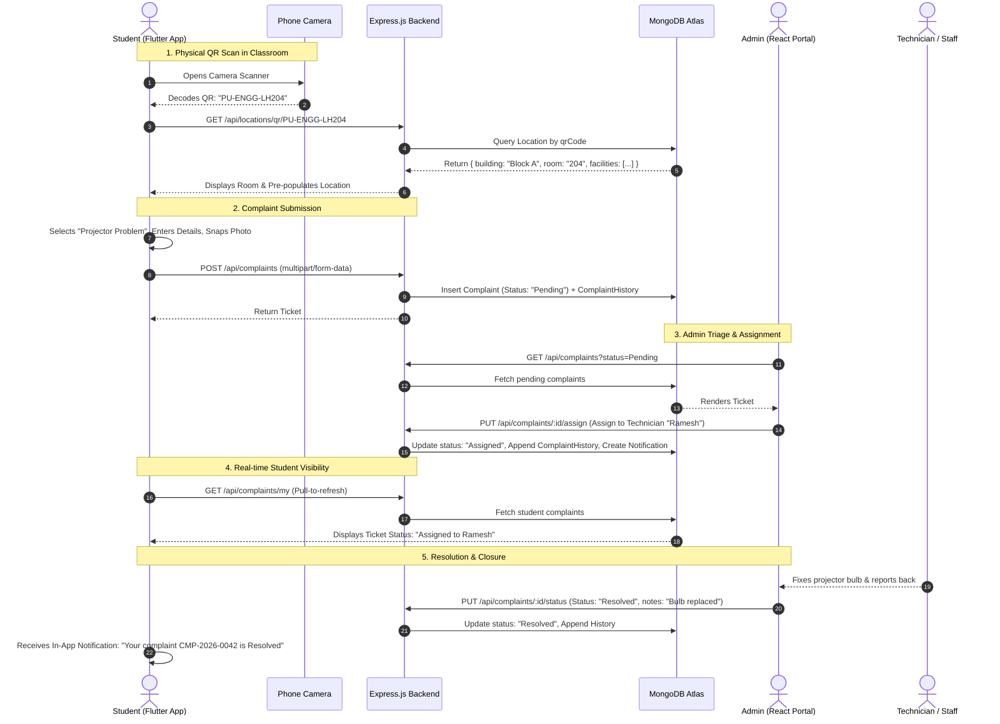
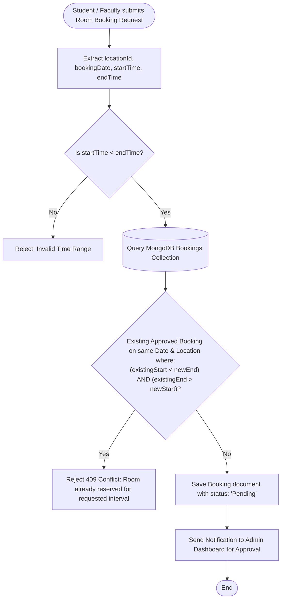
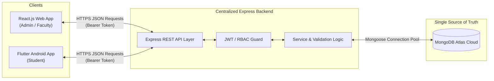

# SMART CAMPUS CONNECT – MASTER WORKFLOW & DATA JOURNEY SPECIFICATION
**Target Evaluation:** MERNOVA X 2026 – Presidency University  
**Focus:** Full Lifecycle Traceability, Synchronization & Data Journey

---

## 1. Flagship Feature: Smart QR Issue Reporting Workflow

---

## 2. Resource Booking Clash Prevention Algorithm

To guarantee campus seminar halls or computer labs are never double-booked, the backend enforces atomic interval checks:

---

## 3. Cross-Platform Data Synchronization Architecture

Both React and Flutter act as thin, reactive presentation clients connected to the same centralized Node.js REST API and MongoDB Atlas cloud database.

---

## 4. Web Application Workflow Specifications

### 4.1 Campus Administrator Incident Triage Workflow
1. **Access:** Administrator navigates to `http://localhost:5173/login`, signs in with `admin@presidencyuniversity.in`, and lands on `/admin`.
2. **Review:** The Executive Dashboard queries `GET /api/analytics/admin-stats` and displays real-time statistics (pending complaints, total students, resolution SLA).
3. **Investigation:** Navigating to `/admin/complaints`, the administrator filters by status (`Pending`) or category (`Projector`). Clicking "Details" opens `/admin/complaints/:id`.
4. **Assignment:** In the complaint details screen, the administrator clicks "Assign Technician", enters the technician's name (*Ramesh Kumar*), phone, and department. Express updates the ticket to `Assigned`, records an entry in `ComplaintHistory`, and automatically creates an in-app notification for the student.
5. **Resolution:** Once work is confirmed, the administrator selects "Update Ticket Status", enters resolution notes, and transitions status to `Resolved`. The student's mobile app immediately displays the resolution upon refresh.

### 4.2 Printable QR Code Generation Workflow
1. **Venue Registration:** Administrator opens `/admin/locations` and clicks "New Campus Venue & QR".
2. **Metadata Entry:** Inputs unique identifier `PU-ENGG-LH204`, building name, block, floor, room number, and installed facilities (*Epson Projector, Central AC*).
3. **Sticker Generation:** Clicking "View QR" triggers the client-side QR renderer, producing a high-resolution 320px QR code embedded in an official Presidency University classroom placard.
4. **Physical Placement:** Administrator clicks "Download Sticker PNG" to obtain a print-ready asset for classroom wall mounting.
